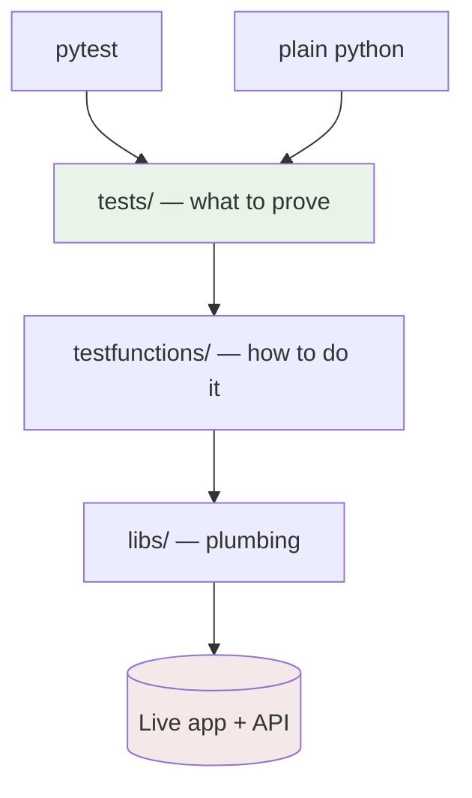

# Part B — Automation: Framework, Tests & Reviewer Guide

> App: `https://qae-assignment-tau.vercel.app/` · Stack: Python 3.11, pytest, requests, Selenium (headless Chrome)
> Author: Brijesh Rathod [bgrathod00@gmail.com]

---

## What this framework is

A small suite that checks the app's money rules through both of its front
doors: the **browser** (what you see) and the **API** (what the server
enforces). **42 tests** in total — 16 API checks, 1 end-to-end UI journey,
25 UI regression checks. Every one runs two ways: `pytest` for reporting,
plain `python` for quick runs.

One design goal drove everything: **a new QA should understand any file in
minutes.** No custom framework, no plugins to learn, no fixtures hiding
behaviour. Here's how the pieces fit:



Tests state intentions, helpers do the work. A test says `attempt_bet(...)`
and asserts on the outcome — it never builds an HTTP request by hand. If you
spot raw `requests` calls inside a test file, that's a smell: move them down
into `testfunctions/`.

---

## The two automated tests (the brief's deliverable)

The assignment asks for one E2E UI journey and one API check. Here's what I
picked, and the honest reasoning:

### 1. E2E UI — `test1_place_bet_happy_path` (`tests/ui_tests/test_e2e_bet.py`)

- **What it does:** opens the app in a real browser, picks an outcome, stakes the minimum, places the bet, checks the receipt appears and the balance drops.
- **Why this one:** it's the **only flow no API test can prove.** The receipt modal, the cleared slip, the button states — none of them exist outside the browser. One test, maximum signal.
- **The cost:** spends EUR 1.00, so it runs only with `--run-bet` and resets the balance on the way out.

### 2. API — `test_below_minimum_rejected` (`tests/api_tests/test_api_business_rules.py`)

- **What it does:** sends stakes of `0.50` and `0.01` straight at `POST /api/place-bet`, demands `422 invalid_stake_min` and no charge.
- **Why this one:** it's the **cheapest test I own** — milliseconds, zero charge, zero flakiness. It also pins the money boundary the spec states two ways (1.00 vs 1.01), and that answer decides the stake the E2E test uses. Boundary rules beat enum checks for regression value per millisecond — and SportyQAD-021 (negative stake paid out) later proved exactly that.
- **The cost:** nothing. Both requests are refused, so it runs in every build.

What they share: each covers ground the other can't reach, and neither can
pass while silently wrong — both assert on the **balance**, not just the
status code.

---

## Directory guide — what lives where

```
Sporty_Test/
├── libs/                        # Reusable helpers. Never contains tests.
│   ├── logger.py                # Logging. get_logger(name) → coloured console + file logs. Use this, never print().
│   ├── rest_helper.py           # REST client (GET/POST/PUT/PATCH/DELETE + dispatcher). All API calls go through here.
│   └── testInitialization.py    # The dual runner — every test file works under pytest AND as plain python.
│
├── libs/testfunctions/          # Named verbs so tests read like intentions, not plumbing.
│   ├── api_helper.py            # Auth + raw calls (balance, matches, place, reset) + the require_balance() guard.
│   ├── api_functions.py         # Scenario verbs (attempt_bet, double_submit, restore_balance) + teardown helpers.
│   ├── rest_api.py              # One typed helper per endpoint, each checking its expected status codes.
│   ├── assert_functions.py      # Shared assertions: status, error codes, balance-unchanged, receipt, payout maths.
│   ├── data_functions.py        # Test-data pickers — no hardcoded match ids, dates or stakes, ever.
│   ├── ui_helper.py             # Selenium driver, waits, screenshots, parallel browsers. UI is a context manager.
│   ├── ui_functions.py          # Browser steps: select odds, enter stake, submit, wait for receipt.
│   └── modal_functions.py       # Receipt / error-modal handling.
│
├── tests/api_tests/             # Money rules (1 file, 16 checks).
│   └── test_api_business_rules.py
├── tests/ui_tests/              # Browser (2 files): the E2E journey + 25 regression checks.
│   ├── test_e2e_bet.py          # Happy-path bet (gated — spends money).
│   └── test_ui_regression.py    # Filters, cards, slip, stake, modals, network, HTTPS.
│
├── documentation/               # Brief + spec transcriptions, API guide, spec-vs-live gap analysis.
│   └── test_strategy/           # 10 cases (TC-001..010) with priority, risk, steps, expected, cost.
├── defectsVault/                # 22 filed defects (15 Bugs + 7 Epics) with screenshots.
├── conftest.py                  # The --run-bet flag. One place, whole suite.
└── .env                         # USER_ID + URLs. Copy from .env.example. Never commit.
```

---

## Reviewer guide — running it yourself

**Setup (once):**

- `python -m venv .venv` → activate → `pip install -r python311_requirements.txt`
- `copy .env.example .env`, then put the test user-id in as `USER_ID`
- Chrome installed (Selenium fetches its own driver — nothing to download)

**The runs:**

- **Free run (default, spends nothing)** — `pytest tests/ -v`. Expect passes, skips (gated money tests) and xfails (open bugs, each naming its defect ID — a red line is always traceable, never a mystery).
- **Cost proof** — read `GET /api/balance` before and after the free run. Money tests skip without `--run-bet`, so a plain run can't spend; the two readings prove it.
- **Gated run (spends real balance — approval only)** — `pytest tests/ -v --run-bet`. The 4 money tests, each resetting the balance afterwards. Deliberate runs only, never CI.
- **Without pytest** — every file is also a script: `python tests/api_tests/test_api_business_rules.py -td check_get_matches,check_get_balance`. No flag = all checks. `-td` picks by name. `-x` stops at the first failure (default: run everything).

---

## House rules — adding a test that fits in

1. **One `check_*` + one `test_*` per behaviour.** Logic lives in `check_` (shared by both runners); `test_` is a one-line pytest wrapper. Register the check in `testSuite(...)`.
2. **Gate anything that moves money.** pytest side: `@pytest.mark.skipif("not config.getoption('--run-bet')", ...)`. Direct-runner side: `setattr(check_fn, "requires", ["--run-bet"])`. And reset the balance in a `finally` — leaving the account dirty is leaving a trap for the next run.
3. **Xfail open bugs — never skip or delete them.** `@pytest.mark.xfail(strict=True, reason="SportyQAD-0NN: ...")` plus the matching `xfail_reason`. A failing bug stays visible; the day it XPASSes, that's the server telling you it's fixed.
4. **Assert money, not just status.** A `422` alone is cheap — also prove the balance didn't move. The balance is the assertion; the status code is the hint.
5. **No hardcoded data.** Ids, dates and stakes come from `pick_*()`. The catalog changes; literals rot.
6. **No `print()`, ever.** `get_logger("<name>")`, type hints on everything, `from __future__ import annotations` first.
7. **Balance moved? Re-run before you file.** The account is shared, so it can shift mid-run (proven: refused requests, moving balance). Poll idle, re-run once — only a repeat failure is a defect.

---

## Deliberately manual-only

- **Receipt and error-modal wording** — each run costs money, and eyes check copy faster than brittle modal assertions. Code proves the receipt *exists*; a person proves it *reads right*.
- **Filters, loading and list rendering** — visual/temporal judgement. Tests here would freeze today's layout, not the rule behind it.
- **Past-match acceptance** — a strict-tracked probe that fails honestly until the server refuses. A green tick over a Critical money bug would be a lie.

The prioritised case list (Top 6 + Optional 4) is in `documentation/test_strategy/README.md`. The scale-up thinking — per-test users, a `data-testid` contract, a spec-first validation matrix — is in `PartC_Strategy_and_Recommendations.md`.
